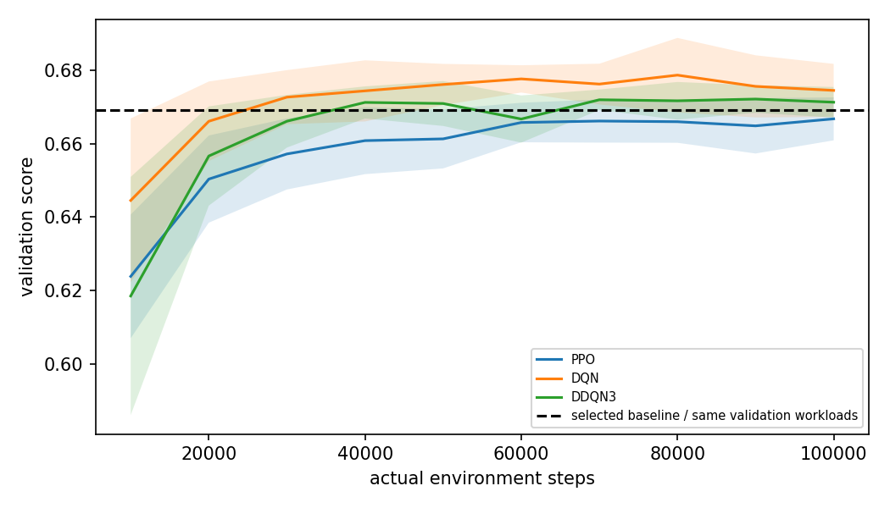

# Quantum Cloud Task Placement

Đồ án NT409 — Project 6: **Task Placement Policies: Heuristics versus Deep Reinforcement Learning**.

So sánh heuristic và DRL trên cùng môi trường đặt tác vụ lượng tử trực tuyến, cùng thông tin đầu vào, reward và workload. Mục tiêu là xác định **điều kiện nào DRL có lợi**, không giả định trước DRL luôn thắng.

## Kết quả chính

Đợt thực nghiệm ngày 09/11/2026 đã hoàn thành **108 lượt tuning + 630 lượt train chính**. Có 21 kịch bản, 3 DRL, 10 training seed/cặp case–thuật toán, 200 test workload/model; tổng cộng 126.000 dòng đánh giá DRL chính.

| So sánh với baseline chọn trên validation | Thắng sau Holm | Thua | Chưa bác bỏ H₀ |
|---|---:|---:|---:|
| PPO | 0 | 11 | 10 |
| DQN | 2 | 5 | 14 |
| DDQN3 | 1 | 6 | 14 |

DQN/DDQN3 thắng tại `rate_r0.5` với Δ score +0,00742/+0,00785. DQN có thêm một chiến thắng ở `reward_legacy`, thuộc mục tiêu khác. **Chưa có bằng chứng DRL vượt heuristic tinh chỉnh một cách tổng quát.** Không bác bỏ H₀ không chứng minh tương đương.

| Base | Score trung bình | T trung bình (giây mô phỏng) |
|---|---:|---:|
| Baseline chọn trên validation | 0,76297 | 12,07 |
| DQN | 0,76246 | 15,17 |
| DDQN3 | 0,75914 | 16,12 |
| PPO | 0,75412 | 16,14 |
| GreedyFlow | 0,68957 | 9,32 |

Các bảng truy vết ở [`results_summary/`](results_summary/). Hình learning curve dùng đúng workload validation cho agent và baseline.



## Bài toán và giả định

- FIFO trên từng QPU, một tác vụ được đặt ở mỗi quyết định; action masking loại node không đủ qubit.
- Observation có `5 + 10N` chiều (55 chiều khi N=5), gồm task, sức chứa/chất lượng node, hàng đợi và ước lượng exec/fidelity tương đối.
- `exec = transpiled_depth × shots / D1CPS`, với `D1CPS = CLOPS × 19.95` là phép quy đổi của mô hình.
- Proxy `F` là tích `(1-error)` theo số cổng/phép đo và lỗi median theo node; `f_rel = F / max_feasible(F)` được tính trong log space.
- Reward chính: `f_rel − beta × log1p(T/t_max)/log(2)`, beta=1, t_max=120s. Score còn trừ penalty reschedule. Hai ablation dùng cost thời gian clipped/linear; không so raw score giữa các reward như cùng mục tiêu.
- Heuristic và agent có cùng thông tin hiện tại. Exec/f_rel chính xác theo simulator; không phải dự báo bất định phần cứng thực. Observation tóm tắt hàng đợi chưa được chứng minh là trạng thái Markov đầy đủ.

## Dữ liệu

Dataset QSimPy chứa đặc trưng MQT Bench đã transpile cho các lớp ibmq7/16/27/127. Gộp hai CSV nguồn rồi chia theo **(họ thuật toán, độ rộng)**, giữ mọi bản ghi cùng nhóm trong một tập:

| Tập | Bản ghi | Nhóm |
|---|---:|---:|
| Train | 45.236 | 444 |
| Validation | 7.334 | 72 |
| Test | 7.430 | 72 |

Các nhóm không giao nhau. Đây là test trên cặp thuật toán–độ rộng chưa thấy; **chưa phải họ thuật toán hoàn toàn mới**. Test đã được xem trong quá trình phát triển, không phải nghiên cứu mù đăng ký trước. Các bản ghi lặp không phải các ứng dụng độc lập.

Calibration là snapshot tĩnh từ IBM Qiskit fake backends. CLOPS/QV và mô hình runtime là tham số mô phỏng; không gọi toàn bộ dữ liệu là phép đo thật trên QPU. Đặc trưng scheduler theo lớp sức chứa, chưa transpile riêng cho từng topology node.

## Các chính sách

12 heuristic: Random, RoundRobin, DRLQ_GreedyWait, FastestNode, BestFidelity, GreedyWait, LeastQueue, GreedyFlow, HybridQueueSpeed, HybridFidelityQueue, HybridEfficiencyRatio, GreedyScore.

`SelectedBaseline` chọn trên 100 workload validation từ 12 heuristic + 30 cấu hình GreedyScoreTuned, rồi đóng băng khi test. Lưới m={1,1.5,2,3,4,6}, lambda={0,0.25,0.5,1,2}; mục tiêu `f_rel − m*beta*cost(T) − lambda*exec/t_max`.

DRL: MaskablePPO (sb3-contrib), DQN và DDQN3 (PyTorch). DDQN3 kết hợp Double, Dueling và 3-step; không phải đầy đủ Rainbow. MLP 128×128. Tuning 4 ứng viên/algorithm ×3 seed ×3 anchor, 20k bước/lượt, validation-only. Cấu hình chọn: PPO lr=3e-4/clip=.2; DQN/DDQN3 lr=5e-4/gamma=.9. Tuning ngắn và lưới nhỏ là giới hạn.

DRLQ_GreedyWait là đối chứng capacity-unaware chẩn đoán reschedule; không tuyên bố tái hiện đầy đủ baseline DRLQ.

## Ma trận thực nghiệm

Base: 5 node, width≤27, 60 task, Poisson .2 task/s, 1024 shots, 100k bước.

| Trục | Các mức gồm base |
|---|---|
| Width cap | 7 / 16 / 27 / 50 qubit |
| Nodes | 3 / 5 / 10 |
| Tasks/episode | 20 / 60 / 120 / 300 / 600 |
| Arrival rate | .05 / .1 / .2 / .5 / 1 task/s |
| Training steps | 20k / 50k / 100k / 300k |
| Interaction | wide_busy: width50, tasks300, rate.5, hai node127; overload: tasks600, rate1 |
| Reward | log1p / legacy_clip / linear |

OFAT tái sử dụng base một lần, cộng interaction và reward thành 21 case; không phải full factorial. Các case train riêng. OOD giữ nguyên model base: 1 ID +7 shift (rate, task, width, burstiness, calibration drift, node slowdown).

## Thống kê và giới hạn diễn giải

- Test workload seed 30000–30199 ghép cặp giữa policy; training seed 0–9.
- CI 95% crossed bootstrap 5000 mẫu lấy lại cả seed và workload; CI chưa hiệu chỉnh đa so sánh.
- T-test trên 10 trung bình seed, có điều kiện trên 200 workload cố định; Holm chung 63 so sánh chính. CI và p-value có phạm vi bất định khác nhau.
- SD giữa training seed tách khỏi SD workload; p95/p99 là trung bình percentile của từng workload, không phải percentile gộp task.
- OOD dùng baseline đã chọn ở base rồi đóng băng. “Best heuristic on OOD” là tham chiếu hậu nghiệm, không phải baseline được chọn trên validation.
- Importance là permutation theo nhóm feature, không chứng minh quan hệ nhân quả; features có thông tin dư thừa.
- Đã bổ sung feature ablation có retraining và beta cho DQN; chưa có ablation từng thành phần DDQN3, masking, node_static hoặc beta PPO/DDQN3; chưa đo thời gian cloud end-to-end hay chạy QPU thật.

## Aer và liên hệ Lab 01

360 cấu hình: Perth/Lagos/Nairobi × n=2..7 × GHZ chain/star × optimization0/2 × seed409..413, 8192 shots. n=2 là Bell, chain/star khi đó trùng mạch.

Đợt Aer cũ bị dừng, nguyên nhân gốc chưa xác định. **Chỉ phân tích `quantum_validation_repaired/`**: density_matrix, một luồng, timeout 120s/cấu hình, checkpoint riêng; xác minh cổng native và lỗi theo physical tuple. `scripts/repair_quantum.py` giữ ở repo root.

Success trong cơ sở Z là tần suất `00...0` hoặc `11...1`; **không đồng nhất fidelity trạng thái hay chứng nhận entanglement**. Wilson CI chỉ bao gồm nhiễu lấy mẫu shots. MAE so với success: layout .01794, median .03963 gộp 360 cấu hình; median tốt hơn tại Perth/Nairobi, layout tốt rõ ở Lagos. Kiểm tra hạng trên 3 backend chỉ có tính khám phá. Aer nhỏ chưa thay mô hình median trong scheduler.

## Cài đặt

Môi trường chạy chính: Python 3.12; các phiên bản thư viện ở `requirements.txt`. Dùng CPU và giới hạn luồng khi so timing.

```bash
conda create -n nt409-v2 python=3.12 -y
conda activate nt409-v2
python -m pip install -r requirements.txt
python experiments/official.py --check
```

Tên conda `nt409-v2` chỉ là tên môi trường đã dùng, không phải phiên bản đồ án. Không thay thư viện/source trong khi train; fingerprint kiểm tra code, data, config và runtime.

## Dùng kết quả đã có

Repo chứa code và bảng/hình gọn ở `results_summary/`; kết quả đầy đủ/model được giữ ngoài Git thông thường. Sau khi tải gói có model, khôi phục cấu trúc:

```text
results/official/
  selected_config.json
  protocol_fingerprint.txt
  ladder/base/case_config.json
  ladder/base/baseline_selection.json
  ladder/base/PPO_seed0/model.zip
  ladder/base/DQN_seed0/model.pt
  ladder/base/DDQN3_seed0/model.pt
  ... các seed và case khác ...
  ladder/tables/ood_per_workload_base.csv
```

Gói `official_return_20261109_070458.zip` **không chứa trọng số**; dùng backup `official_with_models_*.tar.gz` để phục hồi model. Chưa có URL model được xác minh trong repo: không coi clone là đã có pretrained weights.

## Phân tích bổ sung trước hạn nộp

`scripts/supplementary.py` ở root để không đổi fingerprint của core đã train. Không huấn luyện lại; không ghi đè `results/official`. Mỗi lần tạo output có timestamp riêng.

```bash
# Smoke trên model thật: base, 2 seed, 3 workload; OOD vẫn dùng đủ 10×200 dữ liệu có sẵn.
bash scripts/run_supplementary.sh --cases base --n-seeds 2 --workloads 3 --timing-states 5 --timing-repeats 2 --bootstrap 1000

# Đợt đầy đủ: bốn case tiêu biểu, 10 seed, 200 workload.
bash scripts/run_supplementary.sh --n-seeds 10 --workloads 200 --bootstrap 5000

# OOD riêng không cần model; đọc kết quả đã lưu.
bash scripts/run_supplementary.sh --mode ood --bootstrap 5000
```

Output chính:

| File | Ý nghĩa |
|---|---|
| `diagnostics_summary.csv` | Score, T, wait, exec, F theo policy/case, tổng hợp từ từng seed |
| `node_allocation_summary.csv` | Tỷ lệ chọn node, tổng exec được giao, mean width/wait/f_rel và bất đồng với baseline |
| `decision_traces.csv` | Trace seed0 và heuristic trên hai workload đầu; baseline action tính tại trạng thái agent, không phải counterfactual dài hạn |
| `decision_latency_per_seed.csv` | Mean/median/p95 của policy call từng seed, batch1, warmup, CPU một luồng |
| `observation_latency.csv` | Thời gian dựng observation, báo riêng với policy call |
| `ood_inference.csv` | CI crossed bootstrap + conditional seed t-test/Holm trên họ bổ sung 24 so sánh ID/OOD |
| `protocol.json` | Tham số, nền tảng và hash đầu vào/script |

Timing dùng cùng trạng thái trên quỹ đạo baseline, xáo thứ tự đo policy, không gồm load model hay cập nhật simulator; không gọi là độ trễ cloud end-to-end. Tổng exec được giao không phải utilization theo thời gian; muốn utilization cần thêm mẫu số thời gian quan sát. Không sửa kết luận 63 kiểm định chính bằng p-value của họ OOD khác. Ví dụ PPO-ID có thể qua Holm24 mà không qua Holm63 do số so sánh khác nhau.

## Tái tạo từ đầu khi cần

Không chạy lại toàn bộ trước hạn nộp nếu đã có bộ kết quả hoàn chỉnh. `scripts/run_experiments.sh`/`experiments/official.py` lưu giao thức lịch sử, có stage Aer cũ; stage đó chưa được thay đổi để bảo toàn fingerprint. Đường Aer hoàn tất thực tế là script sửa độc lập tại root.

Có thể tái tạo phần classical với cấu hình siêu tham số đã chọn, **không chạy lại tuning**, tại một root mới:

```bash
python experiments/run_ladder.py --config results_summary/selected_config.json --out results/reproduction/ladder --seeds 0 1 2 3 4 5 6 7 8 9 --jobs 4
python experiments/report.py --root results/reproduction/ladder --n-val 100 --bootstrap 5000
python experiments/summarize_metrics.py --root results/reproduction/ladder
python experiments/explain.py --root results/reproduction/ladder --case base --repeats 3
python experiments/ood.py --root results/reproduction/ladder --case base
```

Để lặp nguyên giao thức tuning108, xem `experiments/official.py` và `configs/official.json`; không thay root lịch sử đang lưu kết quả. `scripts/repair_quantum.py` hiện giả định working directory là repo và root `results/official` đã có 630 run; không chạy trên một root khác mà chưa điều chỉnh giao thức. Đây là giới hạn điều phối hiện tại, không phải một lệnh tái tạo end-to-end duy nhất.

## Lưu trữ và nguồn tham khảo

Commit code, cấu hình và bảng/hình gọn. Giữ checkpoint đầy đủ, raw results và backup ngoài Git thông thường; phát hành model qua GitHub Releases hoặc Git LFS khi cần, kèm checksum, cấu hình và hướng dẫn tải. Không commit `.env`, credential, conda environment, cache hay log dài. Quyền sử dụng dataset/mã nguồn kế thừa phải tuân theo giấy phép nguồn; không tự nhận toàn bộ là dữ liệu/mã do nhóm tạo.

- DRLQ: https://arxiv.org/abs/2407.02748
- QFOR: https://arxiv.org/abs/2508.04974
- QSimPy và dataset: https://github.com/Cloudslab/qsimpy ; https://arxiv.org/abs/2405.01021
- MQT Bench: Quantum 7, 1062 (2023).
- Lab 01 và đề Project 6, học phần NT409, UIT, 2026.


## Kết quả bổ sung đã hoàn tất

Đợt supplementary_20261109_135101 hoàn tất: 25.600 lượt đánh giá trên bốn case, 10 seed DRL và 200 workload; kết quả khớp bộ chính. Có 38.400 policy call để đo latency và kiểm định OOD bổ sung với Holm24. Không phát sinh lượt train mới.

Bảng bổ sung: results_summary/supplementary/. Bản thảo cập nhật: docs/Project6_24520820_24521147_23520297.docx.

## Nghiên cứu độ nhạy beta

DQN: beta 0.5 và 2, mỗi mức 10 training seed × 100k bước × 200 test workload; beta 1 dùng lại base. T trung bình lần lượt 22.29, 15.17, 11.92 giây; f_rel 0.95184, 0.91909, 0.89456. Không so sánh trực tiếp score giữa các beta. Hai so sánh mới với baseline tinh chỉnh chưa qua Holm2 (p khoảng 0.103). Bảng và metadata: results_summary/beta/. Bản thảo: docs/Project6_24520820_24521147_23520297.docx.

## Tiếp tục sau bản thảo (13/11/2026)

Đã xác minh fingerprint bộ chính, đủ 630 checkpoint và load thử model từ backup; 13 test qua, demo inference ba case khớp CSV gốc. Giữ nguyên kết quả 3 thắng / 22 thua / 38 chưa bác bỏ sau Holm63. `5f4ab01` là HEAD đã rà, chưa có manifest chứng minh đó là snapshot chính xác của PDF nộp.

[Audit, protocol và lệnh smoke/full](docs/POST_SUBMISSION_20261113.md) ghi rõ OOD 0,4 với baseline retuned trên validation, DQN retraining ablation và kiểm chứng Aer state fidelity. Đợt `post_submission_20261113_054813` đã hoàn tất full và được xác minh: 6.400 dòng OOD, 30 lượt retraining ablation và 72 cấu hình Aer. [Kết quả đầy đủ](docs/POST_SUBMISSION_RESULTS_20261113.md), [bảng/hình/manifest](results_summary/post_submission_full_20261113/). OOD dùng Holm6 và ablation dùng Holm2 riêng, không thay Holm63. Bằng chứng gọn: [results_summary/post_submission_20261113](results_summary/post_submission_20261113/). Bản sửa nội dung sau bản thảo: [DOCX làm việc](docs/Project6_24520820_24521147_23520297_working.docx), giữ nguyên bản gốc.

Demo dự phòng mở `docs/demo/demo.html` trực tiếp trong browser; đây là replay ghi sẵn. Chạy `python scripts/demo_saved_models.py` mới thực hiện inference CPU từ checkpoint rồi sinh replay. Preset là base → rate_r0.5 → tasks_t600.

Kết quả bổ sung: ở OOD 0,4, DQN hơn baseline chọn lại trên validation Δscore=+0,007150 (p Holm6=0,00038363); DDQN3 chưa có bằng chứng hơn baseline này. Retraining tại base: bỏ queue giảm score 0,044792 (p Holm2≈1,67×10⁻⁸); bỏ estimates chưa bác bỏ khác biệt. Aer nhỏ mới so Z-success với state fidelity trước readout, không thay reward scheduler. Các kết luận có phạm vi riêng trong [tài liệu kết quả](docs/POST_SUBMISSION_RESULTS_20261113.md).

## Pilot gamma tại tasks_t600 (validation-only)

Pilot gamma tại tasks_t600 đã hoàn tất 9 lượt huấn luyện trên validation. Gamma 0,99 được chọn để đánh giá trên 200 workload test ghép cặp với gamma 0,90. Gamma 0,99 giảm thời gian chờ nhưng giảm score trung bình 0,016617 điểm và chỉ cải thiện ở 1/3 training seed. Xem [ghi chú kết quả](docs/POST_SUBMISSION_RESULTS_20261113.md) và [bảng kết quả gamma](results_summary/gamma_test_20261113_ok/).
