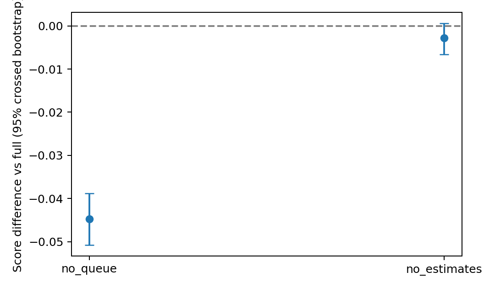
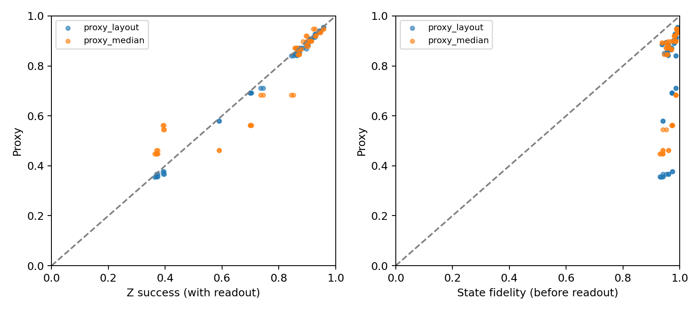

# Kết quả bổ sung sau bản thảo — 13/11/2026

Đợt máy nhóm: `results/post_submission_20261113_054813`. Đã đối chiếu trực tiếp artifact, không chỉ đọc console. Có đủ 6 COMPLETE (3 smoke, 3 full), 30 model retrain, 6.000 dòng ablation, 6.400 dòng OOD, 72 cấu hình Aer. Không thay bộ chính 630 lượt train, 3 thắng / 22 thua / 38 chưa bác bỏ sau Holm63. Có 30 lượt train bổ sung, được tính riêng; 20 lượt beta trước đó cũng tính riêng. Các nghiên cứu sau bản thảo mang tính bổ sung/thăm dò, không phải đăng ký trước.

Bảng/hình và manifest: [`results_summary/post_submission_full_20261113/`](../results_summary/post_submission_full_20261113/). Raw, checkpoint và log giữ nguyên ở root đợt chạy. Script phân tích: `scripts/analyze_post_submission.py`. Phân tích đầu được giữ tại `analysis_initial`; bản cuối tại `analysis_verified`, sửa manifest để chỉ hash log chạy đã đóng, không hash log đang ghi của chính bước phân tích. Toàn bộ manifest cuối đã kiểm hash lại thành công.

## OOD 0,4 task/s: baseline frozen và chọn lại trên validation

Model giữ nguyên từ base 0,2 task/s, training seed0–9. Test workload30000–30199; đối chiếu hash workload từ config/data hiện tại, hash đủ 30 model và fingerprint base. 6.000 dòng DRL được tính lại khớp mọi metric kiểm tra với `rate_x2` cũ (sai khác tối đa 0). Đây không phải case `rate_r0.5`, nơi model train riêng ở 0,5.

Danh mục 42 ứng viên: 12 heuristic và 30 GreedyScoreTuned. Frozen từ base: **m=3, lambda=0**. Chọn lại bằng 100 workload validation5000–5099 ở 0,4: **m=1, lambda=2**, validation score 0,4771625. Code lưu baseline_selection trước đánh giá test; mtime artifact cũng phù hợp thứ tự đó. Không chọn baseline bằng điểm test.

| Policy | Score test | Mean T (s) | Mean f_rel |
|---|---:|---:|---:|
| FrozenBase | 0,579082 | 21,2193 | 0,793879 |
| Retuned04 | 0,610870 | 29,7349 | 0,886872 |
| PPO | 0,573758 | 34,3586 | 0,896972 |
| DQN | 0,618020 | 27,0374 | 0,872456 |
| DDQN3 | 0,612948 | 28,5482 | 0,879380 |

Chênh lệch là DRL trừ baseline, score càng cao càng tốt. CI95% crossed bootstrap 5.000 lần, lấy lại training seed và workload ghép cặp. T-test trên 10 trung bình seed có điều kiện trên 200 workload cố định; Holm6 áp dụng riêng 6 so sánh. CI chưa hiệu chỉnh đa so sánh. Đã tính lại và khớp toàn bộ CI/p-value đã lưu.

| DRL | Baseline | Δ score | CI95% | p Holm6 |
|---|---|---:|---|---:|
| PPO | FrozenBase | −0,005324 | [−0,015264; 0,004956] | 0,437551 |
| PPO | Retuned04 | −0,037112 | [−0,047094; −0,026998] | 0,00007720 |
| DQN | FrozenBase | +0,038938 | [0,034236; 0,043646] | 4,00×10⁻¹⁰ |
| DQN | Retuned04 | +0,007150 | [0,004436; 0,009587] | 0,00038363 |
| DDQN3 | FrozenBase | +0,033866 | [0,028997; 0,038946] | 2,35×10⁻⁸ |
| DDQN3 | Retuned04 | +0,002078 | [−0,001154; 0,005473] | 0,437551 |

DQN giữ lợi thế score nhỏ ngay cả trước baseline chọn lại tại 0,4; DDQN3 chỉ có bằng chứng thắng frozen, chưa có bằng chứng thắng retuned. PPO thua retuned. Đây là kết luận cho shift cụ thể này trong simulator; không chứng minh DRL tổng quát hơn heuristic. Việc đổi baseline làm thay đổi mức lợi thế và cách diễn giải; không dùng heuristic tốt nhất hậu nghiệm trên test làm baseline validation.

## Feature ablation có retraining: DQN tại base

30 lượt mới = 3 biến thể × seed0–9 ×100k bước; mỗi model test200 workload ghép cặp. Đã kiểm config, source/helper fingerprint, model hash, curve10000–100000 và seed/workload. Load lại seed0 của từng biến thể và chạy ba workload: metric tái hiện trong sai số số học <4×10⁻¹⁵. Cả 10 full-features vừa train lại khớp metric bộ chính theo từng workload (sai khác 0); không thay số liệu chính.

Giữ env/reward/mask/hyperparameter/budget, validation20 mỗi10k, final checkpoint và test protocol. `queue` gồm wait/qlen (10 chiều); `estimates` gồm exec/frel (10 chiều); zero cùng nhóm từ đầu train, validation, test và loader. Đây là retraining ablation. Các nhóm còn thông tin dư thừa: bỏ estimates chưa loại mọi thông tin thời gian/chất lượng.

| Biến thể | Score trung bình ± SD seed | Mean T (s) | Mean f_rel |
|---|---:|---:|---:|
| Full | 0,762462 ± 0,007820 | 15,1690 | 0,919093 |
| Bỏ queue | 0,717670 ± 0,006297 | 16,3556 | 0,884627 |
| Bỏ estimates | 0,759639 ± 0,004979 | 15,6880 | 0,920804 |

Chênh lệch biến thể trừ full. Crossed bootstrap ghép cặp 10 training seed ×200 workload, 5.000 mẫu; CI chưa hiệu chỉnh. T-test trên chênh lệch trung bình từng cặp training seed, Holm2 riêng hai so sánh; không gộp Holm6 hay Holm63.

| Biến thể | Δ score | CI95% | p Holm2 |
|---|---:|---|---:|
| Bỏ queue | −0,044792 | [−0,050771; −0,038811] | 1,67×10⁻⁸ |
| Bỏ estimates | −0,002824 | [−0,006580; 0,000585] | 0,161328 |

Nhóm queue giúp DQN tại base theo giao thức này. Chưa bác bỏ khi bỏ estimates không chứng minh feature estimates vô ích hoặc hai mô hình tương đương. Chưa kiểm node_static, chưa tách từng feature đơn hoặc thành phần DDQN3. `train_seconds` trong runner mới bao gồm cả validation, lưu/load và test đến lúc ghi run_meta, nên không dùng trực tiếp để so thời gian train thuần với bộ chính.

## Kiểm chứng lượng tử riêng

72 cấu hình: Perth/Lagos/Nairobi × Bell/GHZ n2/3/4 × chain/star × opt0/2 × seed409/410. 8.192 shots/cấu hình, density_matrix một luồng. Đã kiểm đủ cấu hình/không trùng khóa, ideal Z-success=1 và missing_error_ops=0. Bell n2 chain/star trùng mạch, đã đối chiếu các số đo trùng nhau và loại các hàng n2/star khỏi bảng mô tả chính, còn **60 hàng**; giữ đủ72 raw để truy vết. Các seed không tạo ra 60 calibration hoặc hệ phần cứng độc lập.

Median/layout đều tích xác suất không lỗi theo gate trên cùng ISA, có cả measurement/readout. Layout dùng đúng physical tuple. Z-success đo ISA có readout noise. Fidelity là squared Uhlmann fidelity giữa density matrix noisy và ideal trên cùng full physical register/ISA **trước readout**, bỏ final measurements. Do đó hai target không đồng nhất, và proxy chứa readout không phải ước lượng cùng target với fidelity trước readout. Không xếp hạng proxy chỉ từ việc so MAE khác target.

| Target (60 hàng bỏ Bell trùng) | MAE layout | MAE median |
|---|---:|---:|
| Z-success có readout | 0,010090 | 0,047801 |
| State fidelity trước readout | 0,193907 | 0,188869 |

| Backend | Z-success trung bình | State fidelity trước readout trung bình |
|---|---:|---:|
| Perth | 0,899969 | 0,973602 |
| Lagos | 0,547681 | 0,960996 |
| Nairobi | 0,904144 | 0,968741 |

Trong tập nhỏ này layout gần Z-success hơn median ở cả ba backend; không suy rộng ngược lại kết quả Aer360, nơi miền n/seed khác và median tốt hơn tại một số backend. Ví dụ Bell Lagos opt0/seed409: Z-success=0,73560, fidelity≈0,98535; các giá trị minh họa khác biệt đại lượng, không phải chứng nhận entanglement hoặc phân rã định lượng nguyên nhân nhiễu. Không dùng Aer để suy vì sao scheduler ít chọn Lagos. Chưa thay proxy reward của scheduler; muốn làm cần protocol và quyết định riêng. Không có kiểm định giả thuyết cho bảng MAE mô tả này; shots có nhiễu lấy mẫu, density-matrix fidelity không phải ước lượng từ shots.

## Kiểm tra gamma DQN tại tasks_t600 trên test

Pilot validation chọn gamma=0,99 (mean score 0,57014 so với 0,56810 ở 0,95 và 0,47588 ở 0,90). Sau khi khóa gamma, so sánh checkpoint cuối gamma0,99 với gamma0,90 trên cùng 200 workload test (seed30000–30199), ghép training seed0–2. Cả ba seed đã tham gia pilot chọn gamma; đây là hiệu năng test của các checkpoint đã chọn, không phải ba lần huấn luyện độc lập mới. Protocol và COMPLETE xác nhận đủ sáu checkpoint/hash, 1.200 dòng cặp, test không dùng để chọn gamma. Phân tích này bổ sung riêng ngoài Holm63; gamma0,90 trong bộ chính không đổi.

| Training seed | Score γ=0,90 | Score γ=0,99 | Δ (0,99−0,90) |
|---:|---:|---:|---:|
| 0 | 0,727748 | 0,699042 | −0,028707 |
| 1 | 0,703619 | 0,743285 | +0,039666 |
| 2 | 0,727299 | 0,666490 | −0,060809 |
| Mean | 0,719555 | 0,702939 | −0,016617 |

Điểm của gamma0,99 cao hơn ở 1/3 seed; trung bình thấp hơn 0,01662. Trung bình các chênh lệch metric γ0,99−γ0,90: mean_T −4,2043 s, mean_wait −6,0769 s, mean_exec +1,8727 s, f_rel −0,05834, resched 0 ở cả hai mức. f_rel là fidelity proxy tương đối của simulator, không phải state fidelity lượng tử đo được. Giảm wait/mean_T đi cùng exec cao hơn và proxy fidelity thấp hơn; score kết hợp đánh đổi này.

SelectedBaseline được chọn từ validation tasks_t600 là GreedyScoreTuned_m6.0_l0.0. CSV có đúng 200 workload theo protocol và config tasks_t600 khớp. Đối chiếu mô tả: score baseline 0,734643; DQN γ0,90 0,719555 (Δ−0,015088), γ0,99 0,702939 (Δ−0,031704). Mean T baseline 11,0455 s; γ0,90 17,5812 s; γ0,99 13,3769 s. Đây là đối chiếu mô tả trên workload test, không phải họ kiểm định mới.

CI95% bootstrap theo workload cho Δscore là [−0,019773; −0,013473]; resample 200 workload và điều kiện trên ba checkpoint mỗi gamma. CI này không mô tả bất định từ training seed mới. 600 cặp seed–workload không được xem là 600 lần train. Files nguồn/tái tạo: `results/gamma_test_gamma099_vs_090/`; bảng xác nhận và đối chiếu baseline: `results_summary/gamma_test_20261113_ok/`.

## Tích hợp báo cáo và phần còn lại

Đã thay các placeholder full trong DOCX `_working`, thêm bảng/kết luận và dẫn đường đến CSV. Giữ DOCX/PDF gốc, f_rel=0,9191 ở Bảng5, tên reward log1p và lịch sử DRLQ_GreedyWait. Không tự sửa phân công thành viên. Cần nhóm xác nhận phân công và mở Word/LibreOffice kiểm bố cục/cập nhật mục lục trước xuất PDF. Không cần chạy thêm full cho ba phần này; node_static, gamma tasks_t600 và beta PPO/DDQN3 vẫn để sau, tùy ưu tiên góp ý Thầy.
